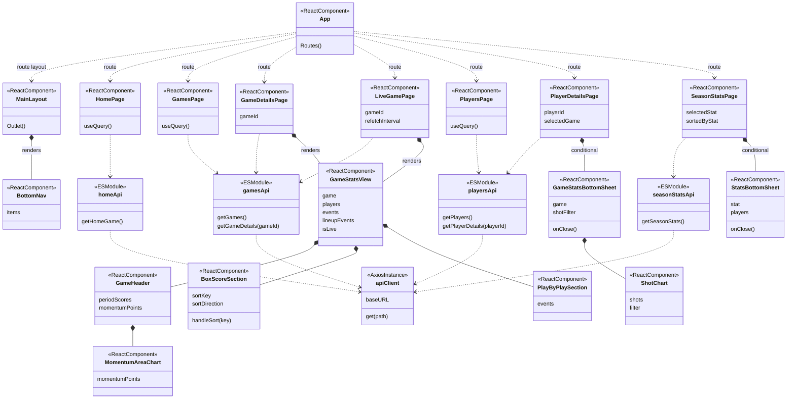
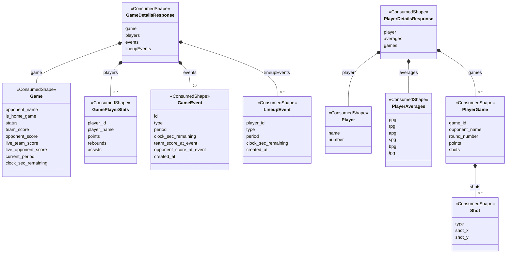
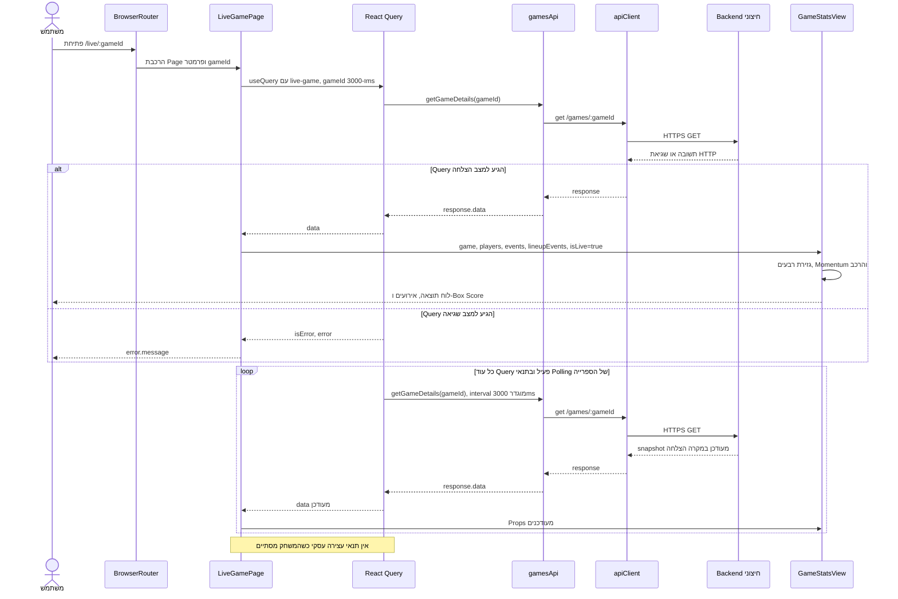
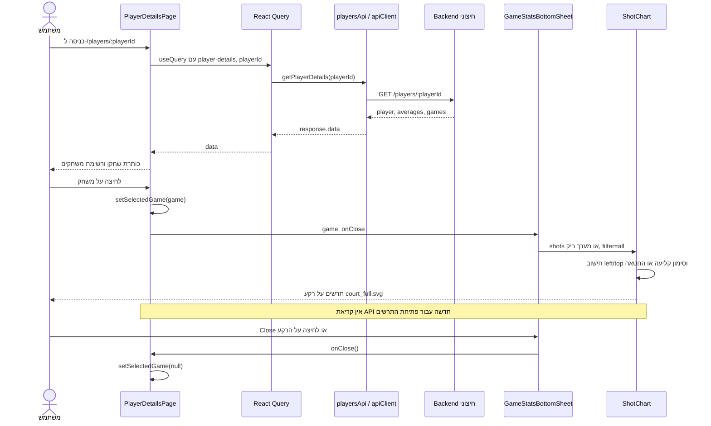
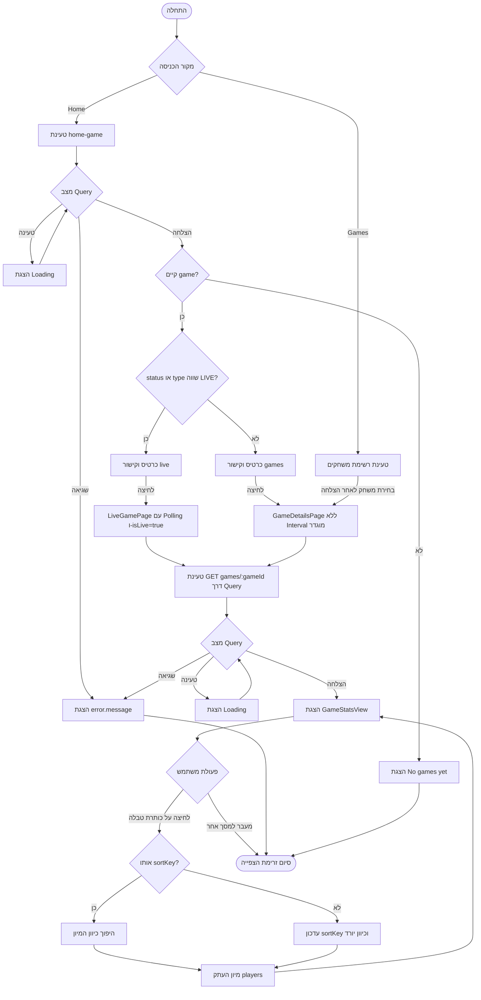

# Detailed System Design — אתר Basketball Tracker

מסמך הקשר הנדסי המבוסס על קוד אתר ה־React בתיקייה `basketball-stats-web`.

## 0. היקף הבדיקה ורמת הוודאות

- **עובדה מאומתת מהקוד**: תיאור של קובץ, רכיב, קריאה, תנאי או חישוב הקיימים במימוש שנבדק. כאשר לא מופיע סימון אחר, תיאורי המימוש במסמך הם מסוג זה.
- **הסקה**: משמעות ארכיטקטונית או השלכה הנגזרת מהקוד, שאינה מוכיחה כוונת מתכנן או התנהגות של מערכת חיצונית.
- **הצעה לשיפור**: שינוי אפשרי בעתיד; אינו חלק מהיכולות הקיימות.

נבדקו כל קובצי JavaScript/JSX וה־CSS ב־`src`, הגדרות החבילות והבנייה, הגדרות ESLint, נקודת הכניסה ב־HTML ונכסי המגרש. המידע מתייחס לגרסת הקוד המקומית בלבד. ה־README הוא בעיקר תבנית React/Vite ואינו מפרט את המערכת העסקית.

**גבול הידע:** בתיקיית האתר אין קוד Backend, סכמת מסד נתונים או מפרט OpenAPI. לא בוצעו קריאות לרשת לצורך תיעוד זה. מבני הנתונים להלן מתארים את השדות שהלקוח קורא ואת הציפיות המשתמעות ממנו, ולא חוזה שרת מאומת. לא ניתן לקבוע מהקוד כיצד השרת שומר מידע, מחשב סטטיסטיקות, בוחר את המשחק במסך הבית, מבצע הרשאות או מקבל אירועי משחק. גם תצורת האירוח של האתר אינה מופיעה כאן.

## 1. ארכיטקטורה וטכנולוגיות

### 1.1 תמונת המערכת

האתר הוא **Single Page Application (SPA)** עם **Client-Side Rendering**. הוא מאפשר צפייה במשחקי קבוצת `Afeka`, נתוני משחק חי, סטטיסטיקות עונתיות ופרטי שחקנים. השם `Afeka` מקודד ברכיבי התצוגה; אין בורר קבוצה.

`index.html` מכיל `div#root` וטוען את `src/main.jsx`. קובץ זה יוצר React Root ומרכיב את העץ:

```text
React.StrictMode
└── QueryClientProvider — מופע QueryClient משותף
    └── BrowserRouter
        └── App — טבלת Routes
            └── MainLayout
                ├── Outlet — המסך התואם לנתיב
                └── BottomNav — ניווט קבוע
```

שכבות המימוש:

1. **Application shell ו־Routing:** `main.jsx`, `App.jsx`, `layout/MainLayout.jsx`, `navigation/BottomNav.jsx`.
2. **Pages:** בחירת Query, טיפול ראשוני בטעינה/שגיאה, State מקומי והרכבת המסך.
3. **Presentation וחישובים:** רכיבים מקומיים בתוך Pages ורכיב המשחק המשותף `GameStatsView`.
4. **API access:** פונקציות ב־`src/api` העוטפות מופע Axios אחד ומחזירות `response.data`.
5. **Backend חיצוני:** יעד HTTPS; המימוש הפנימי שלו אינו חלק מהמקורות שנבדקו.

**הסקה:** זהו מבנה שכבות קל, עם הפרדה בין גישה לרשת לתצוגה. אין Domain Layer עצמאי: חישובי ניקוד, דירוג, הרכב וזריקות נמצאים בקובצי UI. אין בסיס לקבוע שהפרויקט מממש MVC מלא, Clean Architecture או Microservices.

### 1.2 ספריות וכלי עבודה

הגרסאות בטבלה אומתו ב־`package-lock.json`. ב־`package.json` הן מוגדרות עם טווח `^`.

| טכנולוגיה | גרסה נעולה | שימוש בפועל |
|---|---|---|
| React / React DOM | `19.2.6` | Function Components, JSX, Hooks ו־`createRoot` |
| React Router DOM | `7.15.0` | `BrowserRouter`, `Routes`, `Route`, `Outlet`, `Link`, `NavLink`, `useParams` |
| TanStack React Query | `5.100.10` | `QueryClientProvider`, `useQuery`, Cache ו־Polling |
| Axios | `1.16.0` | מופע HTTP משותף וקריאות GET |
| Recharts | `3.8.1` | גרף Momentum באמצעות `AreaChart`, `Area`, `YAxis`, `ReferenceLine`, `ResponsiveContainer` |
| Tailwind CSS / תוסף Vite | `4.3.0` | Utility classes ורספונסיביות; `@import "tailwindcss"` ב־`index.css` |
| Vite | `8.0.12` | Development server, Build ו־Preview |
| `@vitejs/plugin-react` | `6.0.1` | שילוב React ב־Vite |
| ESLint | `10.3.0` | בדיקות סטטיות; תוספי React Hooks ו־React Refresh |

קוד האתר כתוב ב־**JavaScript עם JSX**, במבנה ES Modules (`"type": "module"`). התקנת `@types/react` ו־`@types/react-dom` אינה הופכת את הפרויקט ל־TypeScript; אין קובצי TS/TSX או הגדרות טיפוסים עסקיות.

ה־scripts המוגדרים: `dev` → `vite`, `build` → `vite build`, `lint` → `eslint .`, `preview` → `vite preview`. אין script לבדיקות אוטומטיות. `vite.config.js` רושם את תוספי React ו־Tailwind בלבד; אין בו Proxy ל־API, SSR או תצורת Deploy. אין להציג אפשרויות המוזכרות ב־README התבניתי כיכולות שהופעלו.

## 2. מבנה תיקיות, Pages, Components, Hooks ו־Services

```text
basketball-stats-web/
├── index.html
├── package.json
├── package-lock.json
├── vite.config.js
├── eslint.config.js
├── README.md
├── .gitignore
├── public/
│   ├── court_full.svg
│   ├── court.svg
│   ├── favicon.svg
│   └── icons.svg
└── src/
    ├── main.jsx
    ├── App.jsx
    ├── index.css
    ├── App.css
    ├── api/
    │   ├── apiClient.js
    │   ├── gamesApi.js
    │   ├── homeApi.js
    │   ├── playersApi.js
    │   └── seasonStatsApi.js
    ├── layout/MainLayout.jsx
    ├── navigation/BottomNav.jsx
    ├── components/GameDetails.jsx
    ├── pages/
    │   ├── HomePage.jsx
    │   ├── GamesPage.jsx
    │   ├── GameDetailsPage.jsx
    │   ├── LiveGamePage.jsx
    │   ├── PlayersPage.jsx
    │   ├── PlayerDetailsPage.jsx
    │   └── SeasonStatsPage.jsx
    └── assets/
        ├── hero.png
        ├── react.svg
        └── vite.svg
```

`node_modules` מכיל תלויות מותקנות. `dist` הוא יעד Build צפוי של Vite ומוחרג ב־`.gitignore`; הוא אינו קוד מקור.

### 2.1 מיפוי מסכים ונתיבים

מקור: [src/App.jsx](src/App.jsx), הפונקציה `App`.

| נתיב | Page | תפקיד |
|---|---|---|
| `/` | `HomePage` | משחק יחיד שהתקבל מ־`/games/home`, מוצג כחי או כמשחק האחרון |
| `/season` | `SeasonStatsPage` | כרטיסי דירוג עונתיים ורשימת שחקנים לכל מדד |
| `/games` | `GamesPage` | רשימת משחקים עם תוצאה, תאריך ומחזור |
| `/games/:gameId` | `GameDetailsPage` | תצוגת פרטי משחק; מצב Live נגזר מ־`game.status` אך אין Polling מוגדר |
| `/live/:gameId` | `LiveGamePage` | אותם פרטי משחק עם Polling ותצוגת Live כפויה |
| `/players` | `PlayersPage` | רשימת שחקנים |
| `/players/:playerId` | `PlayerDetailsPage` | פרטי שחקן, ממוצעים, רשימת משחקיו ו־Shot Chart למשחק נבחר |

כל הנתיבים מקוננים תחת `MainLayout`. אין Route מסוג `*`, מסך 404, Redirect פעיל או Route Guard. `Navigate` מיובא אך אינו בשימוש.

### 2.2 רכיבים ופונקציות מרכזיים

| קובץ | רכיבים / פונקציות | אחריות |
|---|---|---|
| `layout/MainLayout.jsx` | `MainLayout` | מעטפת כהה, רוחב תוכן מרבי, מקום לניווט תחתון ו־`Outlet` |
| `navigation/BottomNav.jsx` | `BottomNav`, מערך `items` | ארבעה `NavLink`: Home, Season, Games, Players; צבע מצב פעיל |
| `pages/HomePage.jsx` | `HomePage`, `TeamScoreRow`, `formatClock` | סיכום המשחק שנבחר בשרת, סידור בית/חוץ וקישור למסך המתאים |
| `components/GameDetails.jsx` | `GameStatsView` | הרכבת מסך המשחק וגזירת תוצאה, רבעים, Momentum והרכב |
| אותו קובץ | `GameHeader`, `HeaderTeam`, `MomentumAreaChart` | לוח תוצאה, תאריך/מחזור, שעון, תוצאות רבעים וגרף הפרש |
| אותו קובץ | `BoxScoreSection`, `SortableTh`, `handleSort` | טבלת נתוני שחקנים ומיון מקומי |
| אותו קובץ | `PlayByPlaySection`, `PlayByPlayRow`, `QuarterSeparator` | הצגת אירועים ומפרידי רבעים |
| אותו קובץ | `buildMomentumPoints`, `getGameSecond`, `getPeriodScores`, `getPointsFromEvent`, `getPointsFromEventForTeam`, `getPointsFromEventForOpponent`, `getOnCourtPlayerIds`, `formatClock` | חישובים ופורמט מתוך נתוני המשחק |
| `pages/PlayerDetailsPage.jsx` | `PlayerHeader`, `MainStat`, `MiniStat` | זהות השחקן, ממוצעים ותקצירי משחקים |
| אותו קובץ | `GameStatsBottomSheet`, `SheetStatRow`, `ShotRow`, `ShotChart` | חלונית משחק נבחר, נתוני קליעה ומפת זריקות |
| `pages/SeasonStatsPage.jsx` | `SeasonStatCard`, `PlayerStatRow`, `StatsBottomSheet` | שלושת המובילים ורשימת הדירוג המלאה |
| אותו קובץ | `statCards`, `getAverage`, `getPercentage` | הגדרת מדדים וחישוב ערכים להצגה ולמיון |

שם הקובץ `components/GameDetails.jsx` שונה משם רכיב ה־default export שלו, `GameStatsView`. קובץ זה מכיל 760 שורות ומאגד את מרבית לוגיקת מסך המשחק. רכיבי המשנה הם פונקציות מקומיות, ולא קבצים עצמאיים או מחלקות.

`TeamScoreRow` שבתוך `GameDetails.jsx` אינו מורכב בעץ הפעיל. הרכיב באותו שם ב־`HomePage.jsx` כן בשימוש. גם `FilterButton` שבתוך `PlayerDetailsPage.jsx` מוגדר אך אינו מורכב.

### 2.3 Hooks ו־Services

- אין תיקיית `hooks` ואין Custom Hooks. המסכים משתמשים ישירות ב־`useQuery` וב־`useParams`; State מקומי משתמש ב־`useState`. `SeasonStatsPage` משתמש גם ב־`useMemo`.
- אין שימוש פעיל ב־`useEffect`, `useReducer` או `useMutation` בקוד האתר.
- אין תיקיית `services`. `src/api` ממלאת תפקיד של שכבת API services דקה; אין בה Business Services, מיפוי DTO או Validation.
- אין Redux, Zustand או Context עסקי עצמאי. ה־Provider הגלובלי לנתונים הוא זה של React Query.

### 2.4 עיצוב ונכסים

`src/index.css` מייבא Tailwind, מאפס margin של `body` וקובע `direction: ltr`. `src/App.css` ריק ואינו מיובא. `court_full.svg` נטען מתוך `ShotChart`, ו־`favicon.svg` מופנה מ־`index.html`. לא נמצאה הפניה מקוד האתר ל־`court.svg`, `icons.svg` או קובצי `src/assets`.

## 3. State, ניווט וזרימת נתונים

### 3.1 Server State ו־Cache

ב־[src/main.jsx](src/main.jsx) נוצר `new QueryClient()` פעם אחת ברמת המודול. אין `defaultOptions`, הגדרת Persistence או התאמת מדיניות Cache בפרויקט.

| Page | `queryKey` | `queryFn` | `refetchInterval` מפורש |
|---|---|---|---|
| Home | `["home-game"]` | `getHomeGame` | 5,000ms |
| Games | `["games"]` | `getGames` | אין |
| Game Details | `["game-details", gameId]` | `() => getGameDetails(gameId)` | אין |
| Live Game | `["live-game", gameId]` | `() => getGameDetails(gameId)` | 3,000ms |
| Players | `["players"]` | `getPlayers` | אין |
| Player Details | `["player-details", playerId]` | `() => getPlayerDetails(playerId)` | אין |
| Season Stats | `["season-stats"]` | `getSeasonStats` | אין |

אין הגדרות מפורשות של `staleTime`, `gcTime`, `retry`, `refetchOnWindowFocus`, `refetchIntervalInBackground` או `enabled`. היבטים אלה נשארים למדיניות הספרייה; היעדר Interval אינו מבטיח ש־Query יבוצע רק פעם אחת. לא נקבע כאן ערך Runtime שלא הוגדר בקוד הפרויקט.

אותו `GET /games/:gameId` משמש שני Query Keys שונים. **הסקה:** ה־Cache של מסך Live ושל מסך פרטי משחק נפרד, ואין בקוד סנכרון מפורש ביניהם. גם Home ורשימת Games אינם חולקים אוטומטית Entity Store עם מסך הפרטים.

### 3.2 Local UI State

| בעל ה־State | משתנה | ערך התחלתי | שינוי |
|---|---|---|---|
| `PlayerDetailsPage` | `selectedGame` | `null` | לחיצה על משחק שומרת את אובייקט המשחק; סגירה מחזירה `null` |
| `GameStatsBottomSheet` | `shotFilter` | `"all"` | ה־setter מוגדר אך אינו נקרא; אין שינוי באמצעות UI |
| `SeasonStatsPage` | `selectedStat` | `null` | `See all` שומר את תיאור המדד; סגירה מאפסת |
| `BoxScoreSection` | `sortKey` | `"points"` | בחירת כותרת עמודה |
| `BoxScoreSection` | `sortDirection` | `"desc"` | לחיצה חוזרת הופכת כיוון; עמודה חדשה מתחילה בירידה |

נתונים מחושבים כגון תוצאות רבעים, Shot percentages, שחקנים על המגרש ו־Momentum אינם נשמרים ב־State נפרד. הם נגזרים בזמן Render. `sortedByStat` במסך העונה ממוחזר באמצעות `useMemo` התלוי ב־`data` וב־`selectedStat`.

`selectedGame` מחזיק אובייקט מתוך תשובה קודמת, ולא מזהה שדרכו נגזרת הבחירה מחדש. **הסקה:** אם הנתונים יתרעננו בזמן שהחלונית פתוחה, היא עשויה להמשיך להציג את האובייקט שנבחר קודם. אין Effect המסנכרן את הבחירה לתשובה חדשה.

### 3.3 ניווט וזרימה חד־כיוונית

`Link` ו־`NavLink` מבצעים ניווט פנימי. `gameId` ו־`playerId` נקראים מהנתיב באמצעות `useParams` ומועברים ישירות לפונקציות ה־API. אין בדיקת תקינות מפורשת למזהים.

```text
URL / פעולה של המשתמש
  → Page ו־useParams / useState
  → useQuery עם queryKey
  → פונקציית API
  → apiClient.get(...)
  → response.data
  → React Query / Render של Page
  → Props לרכיבי תצוגה וחישובים נגזרים
  → UI
```

Callbacks עוברים בכיוון ההפוך לצורך עדכון UI מקומי: לדוגמה `onSeeAll`, `onClose`, `onSort`. פתיחת חלוניות אינה משנה URL ואינה מבצעת בקשת רשת נוספת. אין שמירת State ב־`localStorage`, `sessionStorage` או Search Params.

## 4. תקשורת עם ה־Backend ומבני הנתונים

### 4.1 הגדרת HTTP וכל הקריאות

מקור: [src/api/apiClient.js](src/api/apiClient.js).

```js
export const apiClient = axios.create({
  baseURL: "https://basketball-tracker-api.onrender.com",
});
```

כל פונקציות ה־API הן `async`, מבצעות `await apiClient.get(...)` ומחזירות `response.data`. אין שינוי של Response או טיפול `try/catch` בשכבה זו.

| HTTP | Path | פונקציה וקובץ | צרכן | צורת תשובה שהצרכן מצפה לה |
|---|---|---|---|---|
| GET | `/games/home` | `getHomeGame`, `homeApi.js` | Home | `{ type, game }` |
| GET | `/games` | `getGames`, `gamesApi.js` | Games | מערך משחקים |
| GET | `/games/${gameId}` | `getGameDetails`, `gamesApi.js` | Game Details, Live Game | `{ game, players, events, lineupEvents }` |
| GET | `/players` | `getPlayers`, `playersApi.js` | Players | מערך שחקנים |
| GET | `/players/${playerId}` | `getPlayerDetails`, `playersApi.js` | Player Details | `{ player, averages, games }` |
| GET | `/stats/season` | `getSeasonStats`, `seasonStatsApi.js` | Season Stats | מערך סטטיסטיקות שחקנים |

זוהי הרשימה המלאה של קריאות HTTP בקוד האתר. אין Request Body, Query Parameters, Pagination Parameters, POST, PUT, PATCH או DELETE. אין מסכי הזנה/עריכה ואין Mutation. אין צורך להניח endpoint נוסף עבור Shot Chart: הזריקות נקראות מתוך משחקי השחקן בתשובת `/players/:playerId`.

אין בקוד הגדרת Headers עסקיים, Token, Auth Interceptor, `withCredentials`, Timeout מותאם, AbortSignal או משתנה סביבה לכתובת השרת. **אין בכך הוכחה שהשרת עצמו נטול אימות או הרשאות.** הלקוח אינו מפרש קודי שגיאה או סכמת Error Response עסקית.

### 4.2 מוסכמות לתיאור הנתונים

השמות `GameSummary`, `GameDetailsResponse` וכדומה להלן הם **שמות תיעודיים**. אין בקוד Class, Interface או Schema כאלה. סוגי הערכים המדויקים, השדות הנוספים וה־nullability אינם מאומתים מול השרת. המרה באמצעות `Number(...)` מלמדת שהלקוח מנסה לצרוך ערך מספרי; היא אינה מוכיחה שהשרת מחזיר JSON number.

#### א. משחק וסיכום הבית

| שדה | שימוש בצד הלקוח |
|---|---|
| `id` | React key ובניית קישור למשחק ברשימה ובבית |
| `round_number` | הצגת מחזור |
| `game_date_epoch` | `new Date(Number(...))` והצגה באמצעות `toLocaleDateString("he-IL")`; הקוד מתייחס לערך כ־Epoch במילישניות |
| `opponent_name` | שם היריבה |
| `is_home_game` | בדיקת Truthiness לקביעת סדר בית/חוץ; אין המרה מפורשת ל־boolean |
| `team_score`, `opponent_score` | תוצאה רגילה; `team` מתייחס ל־Afeka גם במשחק חוץ |
| `status` | השוואה מדויקת ל־`"LIVE"` בבית ובמסך Game Details |
| `live_team_score`, `live_opponent_score` | תוצאה במצב Live |
| `current_period` | הרבע הנוכחי |
| `clock_sec_remaining` | תצוגת השעון בשניות שנותרו |
| `quarter_length_sec` | אורך רבע לצורך חישוב הזמן ב־Momentum |

אלה שדות הנצרכים יחד על פני המסכים, ולא התחייבות שכל endpoint מחזיר את כולם. רשימת Games צורכת את שדות הזיהוי, המחזור, התאריך, היריבה, בית/חוץ והתוצאה הרגילה; היא אינה קוראת שדות Live. `quarter_length_sec` נצרך רק בפרטי המשחק המשותפים.

בתשובת Home, `data.game` יכול להיות חסר מבחינת ה־UI ואז מוצג `No games yet`. `data.type === "LIVE"` מספיק כדי להציג Live גם אם `game.status` שונה. אין בקוד פירוט של ערכי `type` אחרים או דרך בחירת המשחק בצד השרת.

#### ב. Game Details

```text
GameDetailsResponse
├── game: שדות המשחק הנדרשים בתצוגה
├── players: GamePlayerStats[]
├── events: GameEvent[]
└── lineupEvents: LineupEvent[]
```

ה־Pages מעבירים `events ?? []` ו־`lineupEvents ?? []`. `game` ו־`players` מועברים ללא ברירת מחדל, והרכיבים מניחים שהם קיימים.

| אובייקט | שדות הנקראים בקוד |
|---|---|
| `GamePlayerStats` | `player_id`, `player_number`, `player_name`, `points`, `rebounds`, `assists`, `steals`, `blocks`, `turnovers`, `two_made`, `two_miss`, `three_made`, `three_miss`, `ft_made`, `ft_miss` |
| `GameEvent` | `id`, `type`, `period`, `clock_sec_remaining`, `created_at`, `team_score_at_event`, `opponent_score_at_event`, `player_name`, `assist_player_name` |
| `LineupEvent` | `player_id`, `type`, `period`, `clock_sec_remaining`, `created_at` |

`created_at` מפורש באמצעות `new Date(...)` לשבירת שוויון במיון. אין Parser לתאריך או בדיקת תקינות. `lineupEvents` הוא שם המפתח המדויק בתשובה הנצרכת; אין להסיק ממנו טבלה במסד הנתונים.

#### ג. שחקנים ופרטי שחקן

`GET /players` מצופה להחזיר מערך של רשומות הכוללות `id`, `name`, `number`.

```text
PlayerDetailsResponse
├── player: { name, number, ... }
├── averages: { ppg, rpg, apg, spg, bpg, tpg, ... }
└── games: PlayerGame[]
    └── shots: Shot[]
```

- `player.name` ו־`player.number` מוצגים בכותרת. מספר המשחקים מחושב כ־`games.length`.
- `averages.ppg/rpg/apg/spg/bpg/tpg` מתקבלים כפי שהם מה־API, עם `Number(value ?? 0)` להצגה. האתר אינו מחשב את ששת הממוצעים האלה מתוך `games`.
- `PlayerGame` כולל את השדות הנצרכים: `game_id`, `opponent_name`, `round_number`, `points`, `rebounds`, `defensive_rebounds`, `offensive_rebounds`, `assists`, `turnovers`, `steals`, `blocks`, `two_made`, `two_miss`, `three_made`, `three_miss`, `ft_made`, `ft_miss`, `shots`.
- כל `Shot` נצרך באמצעות `type`, `shot_x`, `shot_y`. אין שימוש ב־Shot ID; React key הוא האינדקס במערך המסונן. כאשר `shots` חסר, מועבר מערך ריק.

#### ד. סטטיסטיקות עונה

`GET /stats/season` מצופה להחזיר מערך רשומות עם השדות:

| קבוצה | שדות |
|---|---|
| זיהוי והשתתפות | `player_id`, `player_name`, `gp` |
| סיכומים שמהם מחושבים ממוצעים | `pts`, `ast`, `reb_total`, `reb_def`, `reb_off`, `stl`, `tov` |
| קליעות וניסיונות | `fgm`, `fga`, `threem`, `threea`, `ftm`, `fta` |

האתר מתייחס לערכים אלה כסיכומים מצטברים לצורך חלוקה ב־`gp`, או כמונה/מכנה לצורך אחוז. אופן הפקת הסיכומים בשרת אינו ידוע. אין פרמטר של עונה בבקשה או בורר עונה ב־UI.

### 4.3 אוצר סוגי האירועים והבדלי המימוש

| שימוש | שמות מדויקים |
|---|---|
| נקודות Afeka ברבעים וב־Play by Play | `FT_MADE`, `TWO_MADE`, `THREE_MADE` |
| נקודות יריבה ברבעים וב־Play by Play | `OPP_FT_MADE`, `OPP_TWO_MADE`, `OPP_THREE_MADE` |
| נקודות יריבה במסנן Momentum | `OPPONENT_FT_MADE`, `OPPONENT_TWO_MADE`, `OPPONENT_THREE_MADE` |
| גבולות רבעים | `PERIOD_START`, `PERIOD_END` |
| שחזור הרכב | `SUB_IN`, `SUB_OUT` |
| זריקה מוצלחת ב־Shot Chart | `TWO_MADE`, `THREE_MADE` בלבד |

**עובדה:** קיים חוסר עקביות בין התחיליות `OPP_` ו־`OPPONENT_`. **הסקה מותנית:** אירוע `OPP_TWO_MADE`, למשל, ייספר ברבע ויוצג כ־2 נקודות, אך לא ייצור נקודת Momentum; אירוע `OPPONENT_TWO_MADE` יוכל ליצור נקודת Momentum אך לא יוסיף ניקוד לרבע ולא יוצג עם ערך 2 ב־Play by Play. אין לקבוע איזו תחילית מגיעה בפועל מהשרת ללא ראיה נוספת. סיווג צד היריבה ב־Play by Play משתמש ב־`startsWith("OPP")` ולכן מכיר בשתי התחיליות.

## 5. תכנון ממשק המשתמש וזרימות משתמש

### 5.1 שפה חזותית ו־Layout

הממשק בפועל כתוב באנגלית, עם תאריכים בפורמט `he-IL` ו־`lang="en"` ב־HTML. כיוון העמוד הוא LTR. כתיבת מסמך זה בעברית אינה מעידה על תמיכת RTL באתר.

השפה החזותית מורכבת מרקע כהה (`#141414`), כרטיסים כהים (`#1F1D1D`, `#2D2A2A`), פינות מעוגלות, טקסט לבן/לבן שקוף והדגשות ירוקות (`#2ECC71`). ציוני Live בפרטי משחק מודגשים באדום. אין Theme Switcher או Design Tokens מרכזיים; ערכי צבע חוזרים בתוך `className`.

`MainLayout` משתמש ב־`max-w-7xl`, padding אופקי ו־`pb-24` כדי לפנות מקום ל־BottomNav הקבוע. סרגל הניווט מחולק לארבע עמודות ומשתמש ב־Emoji. מסך המשחק עובר מעמודה במובייל לחלוקת `md:w-1/3` עבור כותרת ואירועים ו־`md:w-2/3` עבור Box Score. הטבלה גוללת אופקית עם עמודת שחקן דביקה. רשימת האירועים מוגבלת בגובה וגלילה החל מ־`xl`.

### 5.2 Home

מקור: `pages/HomePage.jsx`.

1. מתבצעת שאילתת Home, עם רענון מוגדר כל חמש שניות.
2. טעינה ושגיאה מציגות טקסט; תשובה ללא `game` מציגה `No games yet`.
3. `game.status === "LIVE" || data.type === "LIVE"` קובע את סוג הכרטיס.
4. שם הקבוצה הביתית מוצג ראשון והאורחת שנייה, לפי `is_home_game`.
5. במשחק חי מוצגים רבע ושעון; אחרת מוצגים `LAST GAME` ו־`FT` והקבוצה המנצחת מודגשת.
6. לחיצה פותחת `/live/:id` עבור Live או `/games/:id` אחרת.

הכותרת `LAST GAME` היא בחירת תצוגה לכל משחק שאינו מזוהה כ־Live. האתר אינו בודק בעצמו שזהו המשחק האחרון כרונולוגית או שהמשחק הסתיים.

### 5.3 Games ופרטי משחק

`GamesPage` מציג את המערך בסדר שהתקבל מה־API. בכל כרטיס מופיעים מחזור, תאריך, בית/חוץ, תוצאה ואות `W` או `L` ביחס ל־Afeka. אין מיון, חיפוש, פילטר או Pagination. שוויון מוצג כ־`L`, כי התנאי היחיד עבור `W` הוא `team_score > opponent_score`.

כל כרטיס מפנה ל־`/games/:id`, גם אם המשחק חי. `GameDetailsPage` יכול להעביר `isLive=true` לפי הסטטוס, אבל אינו מגדיר Polling. זהו הבדל תפקודי לעומת כניסה דרך כרטיס Live בבית.

שני מסכי הפרטים משתמשים ב־`GameStatsView` ומציגים כותרת משחק, תוצאות רבעים, Momentum, Play by Play ו־Box Score. אין מתוך טבלת המשחק קישור לשחקן או פתיחת Shot Chart.

### 5.4 Players ופרטי שחקן

`PlayersPage` מציג את מספר השחקנים ואת רשימת השמות ומספרי החולצה. לחיצה פותחת `/players/:id`.

ב־`PlayerDetailsPage` מופיעים זהות השחקן, מספר משחקים ושישה ממוצעים. כל כרטיס משחק מציג יריבה, מחזור, נקודות, ריבאונדים, אסיסטים וחטיפות. לחיצה מעדכנת `selectedGame` ופותחת חלונית עם נתונים שכבר נטענו.

למרות השם `GameStatsBottomSheet`, המימוש בפועל הוא **Drawer ימני**: `top-0 right-0`, גובה מלא, `w-96`, פינות שמאל מעוגלות וגלילה אנכית. אין למימוש זה עיגון לתחתית. הרקע מוחשך; לחיצה עליו או על `Close` סוגרת את החלונית. היא מציגה Shot Chart, אחוזי קליעה, ריבאונד התקפה/הגנה ושאר מדדי המשחק.

### 5.5 Season Stats

המסך מציג 13 כרטיסי מדדים. כל כרטיס מציג את שלושת השחקנים הראשונים אחרי מיון יורד לפי ערך המדד, כולל דירוג, שם, `gp` והערך.

`See all` פותח `StatsBottomSheet` המעוגן לתחתית העמוד, עם גובה מרבי `80vh` ורשימה פנימית גלילה עד `62vh`. גם כאן סגירה אפשרית דרך הרקע או `Close`. אין קריאת API נוספת ואין ניווט לפרטי שחקן מתוך שורת הדירוג.

## 6. משחקים, סטטיסטיקות, Shot Charts ועדכונים חיים

### 6.1 תוצאה ומצב משחק

ב־`GameStatsView` נבחרים `live_team_score/live_opponent_score` כאשר `isLive` אמת, ו־`team_score/opponent_score` אחרת. הערכים מומרים ב־`Number`. אין שם fallback בין Live Score לתוצאה הרגילה.

לעומת זאת, Home משתמש ב־`live_team_score ?? team_score ?? 0` ובביטוי המקביל ליריבה. **הסקה:** בתשובה חסרה עלולים להופיע פערים בין המסכים; `Number(undefined)` בפרטי המשחק מניב `NaN`.

ה־Header מציג `LIVE` ושעון או `FT` ו־`FINAL`. `formatClock` ממיר שניות ל־`minutes:seconds` עם ריפוד לשתי ספרות. ב־Home יש גם `Math.max(0, ...)`; בפונקציה שב־GameDetails אין חסימה של ערכים שליליים. אין Timer מקומי שסופר לאחור, סימולציה של שעון או סנכרון בין שעון השרת לשעון הדפדפן.

### 6.2 תוצאות לפי רבע

מקור: `getPeriodScores` ב־`components/GameDetails.jsx`.

- נוצרים בדיוק ארבעה פריטים לפי `[1, 2, 3, 4]`.
- לכל רבע מסוננים האירועים באמצעות `Number(event.period) === period`.
- סכום הנקודות מחושב מה־`type` באמצעות פונקציות ניקוד נפרדות לקבוצה וליריבה.
- התוצאה ממופה ל־`home/away` לפי `is_home_game`.
- התוצאה הכוללת נלקחת משדות המשחק; היא אינה מחושבת מסכום הרבעים ואין בדיקת התאמה ביניהם.

אין עמודות הארכה או לוגיקה לאורכי רבע שונים עבור הארכות. אירועי רבע 5 ומעלה לא יופיעו בסיכום הרבעים, גם אם קיימים במערך האירועים.

### 6.3 Box Score

`BoxScoreSection` מציג לכל שחקן את `PTS`, `REB`, `AST`, `STL`, `BLK`, `TOV`, `2PT`, `3PT`, `FT`. ניסיונות הקליעה מחושבים כך:

```text
twoAttempts   = Number(two_made)   + Number(two_miss)
threeAttempts = Number(three_made) + Number(three_miss)
ftAttempts    = Number(ft_made)    + Number(ft_miss)
```

התצוגה היא `made/attempts`, ללא אחוז בטבלה זו. כותרות העמודות הן כפתורי מיון; ברירת המחדל היא נקודות בסדר יורד. בעמודות הקליעה המיון מבוסס על מספר הקליעות המוצלחות, לא על אחוז הצלחה. המיון נעשה על `[...players]`, כך שאינו משנה את מערך התשובה המקורי.

אין בטבלה דקות משחק, עבירות, Plus/Minus, שורת סיכום קבוצתית או בחירת קבוצת יריבה. היא מציגה את מערך `players` שנמסר מהשרת, ואין בקוד מנגנון להפרדה בין סגלי שתי קבוצות.

### 6.4 Play by Play

`PlayByPlaySection` עובר על `events` **בסדר שהתקבל**, ללא מיון או היפוך מקומי. `PERIOD_START` ו־`PERIOD_END` הופכים למפרידי רבע. שאר האירועים מוצגים באמצעות `PlayByPlayRow`, עם זמן, ערך נקודות לפי סוג האירוע, תוצאה בנקודת הזמן, שם שחקן ושם מוסר אם קיים.

שם חסר מוחלף ב־`opponentName` באמצעות `??`, גם אם האירוע עצמו אינו מזוהה כאירוע יריב. התוצאה בשורה מוצגת תמיד `team_score_at_event - opponent_score_at_event`, ולא לפי בית/חוץ כפי שמוצג ב־Header. סוג אירוע שאינו מזוהה על ידי `getPointsFromEvent` יקבל תא נקודות ריק; אין מילון תיאורים כללי לריבאונד, איבוד וכדומה.

### 6.5 Momentum

מקור: `buildMomentumPoints`, `getGameSecond`, `MomentumAreaChart`.

1. מסוננים אירועים המופיעים ב־`SCORING_EVENTS` ושיש להם שני שדות תוצאה שאינם `null`/`undefined`.
2. המיון הוא לפי רבע עולה, שעון נותר יורד ו־`created_at` עולה.
3. מחושבים:

```text
gameSecond = (period - 1) * quarterLengthSec
             + (quarterLengthSec - clock_sec_remaining)
minute     = gameSecond / 60, מעוגל לספרה עשרונית
scoreDiff  = team_score_at_event - opponent_score_at_event
```

4. בתחילת הסדרה נוספת נקודת אפס. ברירת המחדל של `quarterLengthSec` היא 600 כאשר הארגומנט אינו מוגדר; אין Validation עבור `null`, אפס או ערך לא תקין.
5. הפרש חיובי מפוצל ל־`positiveDiff` ומצויר בירוק; שלילי ל־`negativeDiff` באדום. טווח Y סימטרי סביב אפס, ותוויות Y מציגות ערך מוחלט.
6. העטיפה מוסתרת ב־CSS אם אין אף הפרש שונה מאפס.

**משמעות:** זהו גרף הפרש נקודות מנקודת המבט של Afeka, ולא מדד הסתברות ניצחון. למרות חישוב `minute` ו־`gameSecond`, אין `XAxis` פעיל הקשור לערכים אלה; אין לייחס לגרף קנה מידה מספרי של זמן משחק. `XAxis` ו־`Tooltip` מיובאים אך אינם בשימוש. אין Tooltip פעיל או מידע על נקודה בלחיצה.

### 6.6 שחזור שחקנים על המגרש

`getOnCourtPlayerIds(lineupEvents)` מתחיל ב־`Set` ריק. הוא ממיין העתק של האירועים לפי רבע עולה, שעון נותר יורד ו־`created_at` עולה. לכל אירוע עם `player_id` אמת:

- `SUB_IN` מוסיף `String(player_id)`.
- `SUB_OUT` מסיר `String(player_id)`.

הרכיב משווה את התוצאה ל־`String(player.player_id)`, מדגיש את מספר החולצה ומוסיף `ON COURT` במצב Live. במשחק שאינו Live מועבר Set ריק.

**מגבלה מאומתת:** אין טעינת חמישייה התחלתית נפרדת, איפוס אוטומטי בתחילת רבע או אכיפה של חמישה שחקנים. **הסקה:** נכונות התצוגה תלויה בכך שהאירועים הנמסרים מספיקים לשחזור המצב, לרבות כניסת שחקני ההרכב הראשוני. אין להסיק שהשרת אכן מספק רצף מלא.

### 6.7 Shot Chart וסטטיסטיקות קליעה לשחקן

מקור: `GameStatsBottomSheet`, `ShotRow`, `ShotChart` ב־`pages/PlayerDetailsPage.jsx`.

התרשים מציג רק את `shots` של **השחקן במשחק שנבחר**. הוא אינו Shot Chart קבוצתי או עונתי. הרקע הוא SVG סטטי `/court_full.svg` עם `viewBox="0 0 15 14"`; הסימונים הם רכיבי HTML במיקום Absolute, ולא תרשים Recharts או Canvas.

```text
left = (Number(shot.shot_x) / 15) * 100%
top  = (Number(shot.shot_y) / 14) * 100%
```

יחס המעטפת הוא `15/14`, ורוחבה המרבי `320px`. `TWO_MADE` ו־`THREE_MADE` מוצגים כטבעת ירוקה; כל סוג אחר מוצג כ־X אדום. אין בדיקת גבולות, סינון קואורדינטות לא תקינות, היפוך כיוון התקפה, Tooltip או מקרא מפורש. אין להסיק מהקוד יחידת מידה פיזיקלית של הקואורדינטות או דרך מדידתן.

`ShotChart` מכיל ענפי סינון ל־`all`, `makes`, `misses`, אבל ההורה מעביר State שתמיד מתחיל ב־`all` ואינו משתנה. לכן **אין למשתמש יכולת פעילה לסנן זריקות**. גם ההנחה ש־`shots` מכיל רק זריקות שדה לא נאכפת: למשל `FT_MADE` היה מסומן כ־X אם היה מגיע במערך.

`ShotRow` מחשב `made / attempts * 100`, מעוגל למספר שלם ומחזיר 0 כשאין ניסיונות. Field Goals מחושב כסכום קליעות וניסיונות של 2 ו־3 בלבד. ריבאונד התקפה/הגנה מוצג משדות התשובה; הוא אינו מחושב מתוך אירועים.

### 6.8 סטטיסטיקות עונתיות

מקור: `statCards`, `getAverage`, `getPercentage` ב־`SeasonStatsPage.jsx`.

| כרטיס | חישוב בצד הלקוח |
|---|---|
| Points / PPG | `pts / gp` |
| Assists / APG | `ast / gp` |
| Rebounds / RPG | `reb_total / gp` |
| Defensive Rebounds / DRPG | `reb_def / gp` |
| Offensive Rebounds / ORPG | `reb_off / gp` |
| Steals / SPG | `stl / gp` |
| Turnovers / TPG | `tov / gp` |
| Field Goal % | `fgm / fga * 100` |
| Three Point % | `threem / threea * 100` |
| Free Throw % | `ftm / fta * 100` |
| Field Goals / FG | `fgm / gp` |
| Three Pointers / 3PT | `threem / gp` |
| Free Throws / FT | `ftm / gp` |

ממוצעים מעוגלים לספרה אחת ומוחזרים מ־`toFixed(1)` כמחרוזת; ב־`gp=0` מוחזר 0. אחוזים מוצגים עם ספרה אחת ו־`%`, עם הגנות מסוימות מפני מכנה לא חיובי ו־`NaN`.

המיון משתמש בערכים המעוגלים, ולכן ערכים שונים לפני העיגול עשויים לקבל אותו ערך דירוג. כל הכרטיסים ממוינים בירידה, גם Turnovers. אין מינימום משחקים/ניסיונות לדירוג אחוזים, אין כלל עסקי לשבירת שוויון, ואין כרטיס Blocks עונתי אף שקיים מדד Blocks במסכים אחרים. שלושת כרטיסי כמות הקליעות מציגים ממוצע למשחק, למרות תוויות שאינן כוללות `PG`.

### 6.9 משמעות המונח Real-time במימוש

המימוש משתמש ב־**Polling של HTTP snapshots**: כל חמש שניות בבית וכל שלוש שניות במסך Live, בכפוף להתנהגות React Query והדפדפן. אין WebSocket, Server-Sent Events, Stream או עדכון Delta בקוד.

כל רענון מבקש שוב את תשובת ה־endpoint; אין פרמטר `since` או מזהה אירוע אחרון. אין הבטחת זמן אמת קשיח, שעון רציף, מחוון זמן עדכון אחרון או טיפול עסקי בניתוק.

`LiveGamePage` מעביר תמיד `isLive={true}` ו־Interval קבוע: אין הפסקת Polling או מעבר אוטומטי לסיכום כשהשרת מחזיר סטטוס סיום. Home ממשיך Polling גם כאשר הוא מציג משחק שאינו Live. אלה תוצאות ישירות של הגדרת ה־Queries, ולא תיאור של התנהגות השרת.

## 7. תרשימי UML ב־Mermaid

### 7.1 Class Diagram — רכיבים ומודולים קיימים

אין בקוד מחלקות עסקיות. התרשים משתמש ב־Class notation עם סטריאוטיפים כדי לתאר **Function Components ומודולי פונקציות**, ולא לטעון לקיומן של מחלקות JavaScript. חלק מהרכיבים המקומיים הושמטו לשם קריאות; אין בתרשים ירושה עסקית.



האזכורים של `useQuery`, `Routes` ו־`Outlet` בתרשים מסמנים שימוש ב־Hook או ברכיב בתוך Function Component, ולא מתודות של מחלקה. `refetchInterval` הוא שדה תצורה של Query. פרטי ה־Queries ו־QueryClientProvider מתוארים בסעיפים 1–3.

### 7.2 Class Diagram — מבני תשובה נצרכים

זהו תיאור DTO מושגי של אובייקטים שהקוד קורא. קשרי ההכלה מתארים קינון ב־Response, **לא קשרים או מפתחות זרים במסד נתונים**. רשימת השדות המלאה שנצרכת מפורטת בסעיף 4.



### 7.3 Sequence Diagram — טעינה ורענון של משחק חי

התרשים מציג מסלול טעינה כאשר נדרשת בקשת רשת. Cache ומדיניות הספרייה יכולים להשפיע על מועד הבקשה; השרת מופיע כ־Black Box.



### 7.4 Sequence Diagram — פרטי שחקן ופתיחת Shot Chart



### 7.5 Activity Diagram — צפייה במשחק ומיון נתוניו

Mermaid מציג כאן Activity flow באמצעות תחביר `flowchart`, עם התחלה, החלטות, פעולות וסיום; אין טענה שזהו פורמט UML Activity מקורי של Mermaid.



תרשים ה־Activity מתמקד בנתיבי הניווט והמיון. Polling ברקע מתואר בתרשים Sequence; שגיאת רשימת Games מטופלת באותו דפוס טקסטואלי כמו יתר ה־Pages.

## 8. מודולים, תחומי אחריות ותלויות

| מודול לוגי | קבצים | אחריות | תלויות עיקריות |
|---|---|---|---|
| Bootstrap | `index.html`, `main.jsx` | יצירת Root, Providers וטעינת CSS | React DOM, Router, React Query |
| Application shell | `App.jsx`, `MainLayout.jsx`, `BottomNav.jsx` | מיפוי כתובות ומסגרת ניווט | React Router וכל ה־Pages |
| Home | `HomePage.jsx`, `homeApi.js` | סיכום המשחק שקיבל הלקוח וכניסה לפרטים | React Query, Router, Axios client |
| Games | `GamesPage.jsx`, `GameDetailsPage.jsx`, `LiveGamePage.jsx`, `gamesApi.js` | רשימה, טעינת פרטים ומדיניות רענון | React Query, Router, `GameStatsView` |
| Game presentation | `components/GameDetails.jsx` | לוח תוצאה, Box Score, אירועים וחישובים נגזרים | React State, Recharts, מבנה נתוני ה־API |
| Players | `PlayersPage.jsx`, `PlayerDetailsPage.jsx`, `playersApi.js` | סגל, ממוצעים, משחקי שחקן ו־Shot Chart | React Query, Router, SVG סטטי |
| Season statistics | `SeasonStatsPage.jsx`, `seasonStatsApi.js` | חישוב דירוגים ותצוגת מדדים | React Query, React State/Memo |
| HTTP infrastructure | `apiClient.js` | URL בסיסי ומופע Axios משותף | Axios ושרת חיצוני |
| Styling/assets | `index.css`, מחלקות Tailwind, `public` | צבעים, Layout, רספונסיביות ומגרש | Tailwind ותוסף הבנייה |

התלות העיקרית היא `Page → API module → apiClient`, ובמקביל `Page → UI components`. רכיבי התצוגה המשותפים אינם מבצעים קריאות רשת. `GameDetails.jsx` מייבא `useQuery` ו־`useParams` אך אינו משתמש בהם; אין לראות ב־imports האלה Fetching פעיל.

אין הפרדת קוד לפי חבילות עצמאיות, אין dependency injection framework, ואין חוזה DTO מרכזי. כל מסך מכיר ישירות שמות שדות מהשרת, ולעיתים מוסכמות שונות לאותה משמעות: למשל `pts` בעונה מול `points` במשחק, ו־`player_name` מול `name`.

## 9. Design Patterns, Cohesion, Coupling ו־Conway's Law

הסיווגים בסעיף זה הם **ניתוח והסקה של מבנה הקוד**, ולא הצהרה על כוונת המפתח.

### 9.1 דפוסים מזוהים

| דפוס | ראיה במימוש | גבולות הפרשנות |
|---|---|---|
| Component Composition | Pages מרכיבים רכיבי משנה; שני מסכי משחק מרכיבים `GameStatsView` | הרכבה באמצעות Props, ללא היררכיית ירושה עסקית |
| Container / Presentational separation | `LiveGamePage` ו־`GameDetailsPage` טוענים מידע ומעבירים לתצוגה משותפת | הפרדה חלקית: Pages אחרים מכילים גם UI וחישובים רבים |
| API Facade / Gateway דק | `getGames`, `getPlayerDetails` וכו' מסתירים שימוש ישיר ב־Axios מה־Pages | אין Repository מלא, Mapping או Domain Model |
| Provider | `QueryClientProvider` מספק QueryClient לכל עץ המסכים | זהו שימוש במנגנון ספרייה, לא Container עסקי עצמאי |
| Observer-style updates | `useQuery` מקשר את התצוגה לנתוני Query ולמצבם | המנגנון מנוהל ב־React Query; אין Event Bus מותאם |
| Data-driven rendering / Strategy-like callbacks | `statCards` מספק `key` או `customValue` לאותו רכיב כרטיס | זהו מערך תצורה ופונקציות, לא מחלקות Strategy |
| Event replay מקומי | `getOnCourtPlayerIds` מעבד `SUB_IN/SUB_OUT` לשחזור Set | אין ראיה ל־Event Sourcing בצד השרת או למסד אירועים |
| Shared module instance | מופע `apiClient` ומופע `QueryClient` נוצרים ברמת מודול | אין מימוש מפורש של מחלקת Singleton |

### 9.2 Cohesion

- **גבוהה יחסית:** `apiClient.js` עוסק בהגדרת HTTP בלבד; מודולי API מחולקים לפי תחום; `BottomNav` עוסק בניווט; `SortableTh` מתמקד בכותרת מיון.
- **בינונית:** `SeasonStatsPage.jsx` מאחד חישובי מדדים, הגדרת קטגוריות, מיון וכמה רכיבי תצוגה סביב תחום אחד.
- **נמוכה יותר ברמת הקובץ:** `GameDetails.jsx` מאחד הרכבת מסך, תצוגת טבלה, אירועים, גרף, עיצוב, פורמט זמן וחוקי ניקוד. `PlayerDetailsPage.jsx` מאחד שאילתה, רשימת משחקים, Drawer, מדדי קליעה ומיפוי קואורדינטות.

ריבוי רכיבים בקובץ אינו כשלעצמו תקלה, אך מרכז כמה סיבות שונות לשינוי באותו מקום. ה־imports והרכיבים הלא פעילים מעידים על קוד שנותר בקובץ; אין להסיק מהם תהליך פיתוח מסוים.

### 9.3 Coupling

- **תלות נמוכה יותר בפרוטוקול בתוך UI:** רוב המסכים תלויים בפונקציות API ולא ב־Axios ישירות.
- **תלות גבוהה בצורת הנתונים:** שמות שדות וסוגי אירועים מפוזרים ב־JSX ובחישובים. שינוי API יחייב התאמות בכמה צרכנים.
- **תלות במוסכמות תחום:** `Afeka`, ארבעה רבעים, ברירת מחדל 600 שניות ומערכת קואורדינטות `15×14` נמצאים בקוד ללא Configuration עסקי מרכזי.
- **שיתוף מועיל אך ריכוז אחריות:** שני מסכי המשחק משתמשים באותו UI, ולכן שינוי תצוגה אחד משפיע על שניהם. מדיניות ה־Live עדיין נפרדת ב־Pages ועלולה להיות שונה.
- **כפילות:** `formatClock` וסידור בית/חוץ קיימים ביותר ממקום אחד; בפועל כבר קיימים הבדלי fallback וגבולות זמן.

### 9.4 Conway's Law

אין בקוד ראיה מספקת למספר אנשי הצוות, חלוקת תפקידים, גבולות תקשורת או מבנה ארגוני. לכן **לא ניתן לקבוע שהמערכת מאשרת או מפריכה את Conway's Law**, או שספרייה מסוימת נוצרה בידי צוות נפרד.

אפשר לזהות גבול טכני בין Client React ל־HTTP API חיצוני וחלוקה מקומית לפי תחומי Games, Players ו־Season. **הסקה אפשרית בלבד:** גבולות אלה יכולים לשמש חלוקת אחריות בין מפתחי Client ו־Server או בין תחומים. הם אינם מוכיחים שכך הצוות עבד בפועל. לדיון אקדמי מבוסס נדרשות ראיות נוספות כגון חלוקת עבודה מתועדת, ראיונות או תהליך תיאום ה־API.

## 10. שגיאות, ביצועים, מגבלות והחלטות תכנון

### 10.1 טיפול קיים בשגיאות ובמצבי קצה

כל שבעת ה־Pages קוראים `isLoading`, `isError`, `error` מ־`useQuery`. בזמן טעינה מוצג טקסט; בזמן שגיאה מוצג `error.message`. `LiveGamePage` משתמש בטקסט `Loading live game...`.

קיימות הגנות נקודתיות: ברירת מחדל `data=[]` ברשימות, `events ?? []`, `lineupEvents ?? []`, `shots ?? []`, טיפול ב־Home ללא משחק, וחסימת חלוקה באפס בחלק מהפונקציות. ברירת המחדל `data=[]` אינה מגינה מפני Response שהוא `null` או אובייקט במקום מערך.

אין Error Boundary, Runtime Schema Validation, הודעת שגיאה מותאמת ל־404/401/500, כפתור Retry ידני, תצוגת Retry Count, Error Logging מרוחק או הבחנה עסקית בין כישלון רענון לטעינה ראשונית. אם Query מדווח על `isError`, הענף בקוד מחזיר הודעת שגיאה גם אם יש Cache קודם. שגיאת Render עקב Payload לא תקין אינה מטופלת בענף `isError` של בקשת הרשת.

רשימות ריקות ב־Games וב־Players מוצגות ללא הודעת Empty State ייעודית; Players מציג `0 players`. מסך עונה ריק עדיין מייצר את כרטיסי המדדים ללא שחקנים. אין בדיקות עקביות בין שדות התוצאה, האירועים והסטטיסטיקות.

### 10.2 ביצועים — עובדות והסקות

**מנגנונים קיימים:** Cache משותף של React Query; שימוש חוזר ברכיב המשחק; העתקת מערכים לפני מיון; `useMemo` לרשימת הדירוג שנבחרה בעונה; ResponsiveContainer לגרף. העתקה לפני מיון תורמת לשמירת נתוני המקור ואינה אופטימיזציית מהירות בפני עצמה.

**הסקות לפי האלגוריתמים, ללא Benchmark:**

- עם `E` אירועים, בניית Momentum היא בקירוב `O(E log E)` בגלל מיון; סיכום ארבעת הרבעים הוא `O(E)` עם כמה מעברים קבועים.
- עם `L` אירועי הרכב, שחזור ההרכב הוא `O(L log L)`; עם `P` שחקנים, מיון Box Score הוא `O(P log P)`.
- כל אחד מ־13 כרטיסי העונה ממיין את רשימת השחקנים מחדש לפני `slice(0,3)`; העלות הכוללת היא בקירוב `O(13 × P log P)` בכל Render של הכרטיסים. `useMemo` של הרשימה המלאה אינו ממחזר את המיונים האלה.
- Shot Chart יוצר אלמנט לכל זריקה מסוננת; Play by Play יוצר אלמנט לכל אירוע. גלילה ב־CSS אינה Virtualization.
- אין Memoization מפורש לחישובי המשחק, `React.memo`, Route Lazy Loading, Pagination או Windowing. כל ה־Pages מיובאים סטטית ב־`App.jsx`.
- Polling מעביר snapshots שלמים: אם רשימת האירועים גדלה, עשויים לגדול גם תעבורת הרשת ועלות החישוב. לא נמדדו גודל Payload, Bundle, Latency או FPS ולכן אין כאן טענות כמותיות על ביצועי המערכת.

### 10.3 מגבלות ופערי מימוש מאומתים

| נושא | ראיה בקוד | השלכה אפשרית / גבול היכולת |
|---|---|---|
| שמות אירועי יריבה | `SCORING_EVENTS` מול פונקציות הניקוד ב־`GameDetails.jsx` | Momentum וסיכום רבעים עשויים לפרש אירוע אחרת; תלוי בנתוני השרת |
| כניסה ל־Live דרך Games | קישור תמיד ל־`/games/:id`; ב־Page אין Interval | תצוגת LIVE יכולה להופיע ללא Polling מחזורי מפורש |
| סיום משחק חי | `LiveGamePage` מעביר `true` תמיד | אין מעבר אוטומטי ל־FINAL או עצירת Polling לפי סטטוס |
| סינון Shot Chart | `setShotFilter` ו־`FilterButton` אינם בשימוש | ענפי makes/misses קיימים אך אינם זמינים למשתמש |
| תחום הזריקות | כל type מלבד TWO_MADE/THREE_MADE מסומן כהחטאה | נדרש Payload מתאים; סוגים נוספים יפורשו בצורה זו |
| תוצאות חסרות | `Number(game.live_team_score)` ללא fallback בפרטי משחק | ערכים חסרים או לא מספריים עשויים להציג `NaN` |
| השוואות ברשימת משחקים | השוואת `team_score` ו־`opponent_score` ללא `Number` | אם שניהם מחרוזות, ייתכן סדר לקסיקוגרפי במקום מספרי |
| בית/חוץ | שימוש ישיר ב־Truthiness של `is_home_game` | מחרוזת `"false"`, אם תתקבל, תיחשב אמת |
| תוצאות רבעים | `[1,2,3,4]` בלבד | אין הצגת הארכות בסיכום |
| שעון | אין Countdown מקומי | תצוגת השעון משתנה עם תשובות, לא בכל שנייה |
| גרף זמן | אין XAxis המחובר ל־minute/gameSecond | אין ציר זמן מספרי מפורש, אף שערכי זמן מחושבים |
| טבלת משחק | שורות אינן Link/כפתור | אין מעבר לשחקן או Shot Chart מה־Box Score |
| דירוג עונתי | עיגול לפני מיון, סדר יורד לכולם | שוויונות עקב עיגול ו־Turnovers גבוהים בראש |
| סגל על המגרש | Set ריק + SUB_IN/SUB_OUT | תלות בשלמות האירועים; אין אכיפת חמישייה |
| חלונית שחקן | `w-96` ללא התאמת רוחב למסך צר | עלולה לחרוג מרוחב מסך צר; לא בוצעה בדיקת דפדפן |
| Accessibility של חלוניות | אין `role="dialog"`, `aria-modal`, Focus Trap או Escape handler מפורש | ניהול מיקוד/מקלדת אינו ממומש בקוד; כפתור הרקע חסר שם נגיש מפורש |
| Accessibility של נתונים | אין `aria-sort` מפורש בטבלה או תיאור טקסט לכל Shot marker | התמיכה אינה מתועדת כמלאה; קיימים כפתורים טבעיים ו־alt לתמונת המגרש |
| נתיב לא מוכר | אין Catch-all Route | אין מסך 404 ייעודי ב־SPA |
| פריסה | BrowserRouter, נתיבי assets שמתחילים ב־`/` | אירוח בנתיבי משנה ורענון URL עמוק דורשים התאמת hosting; אין תצורה כזו במקורות |
| תחזוקה | imports, משתנים ורכיבים לא בשימוש | Lint נכשל; פירוט בבדיקות בסוף המסמך |

ההשלכות המותנות בטבלה אינן דיווח על תקלה שנצפתה מול נתוני ייצור. הן נגזרות מתנאי הקוד. לא בוצעה בדיקת נגישות או רספונסיביות בדפדפן.

### 10.4 החלטות מימוש נצפות והמשמעות שלהן

אין בפרויקט ADRs או נימוקים מפורשים להחלטות. עמודת המשמעות היא **הסקה**, ולא הסבר של כוונת המתכנן.

| בחירה שקיימת בקוד | משמעות / Trade-off |
|---|---|
| SPA עם Client Routing | מעבר פנימי בין מסכים ללא תבניות שרת; אירוח צריך לתמוך בכניסה לנתיבים עמוקים |
| React Query ל־Server State ו־useState ל־UI | הפרדה בין טעינת נתונים למצב אינטראקציה, בלי Store עסקי נוסף |
| Polling ב־Home וב־Live | מנגנון לקוח פשוט לעדכון snapshots, במחיר בקשות חוזרות ופערי זמן בין עדכונים |
| API wrappers דקים | קל לעקוב אחרי endpoint; אין נקודת נרמול מרכזית לנתונים |
| `GameStatsView` משותף | תצוגה עקבית לשני מסכי המשחק, אך מדיניות הרענון נשארת נפרדת |
| חישובים מתוך events בצד הלקוח | אפשר להפיק רבעים/גרף/הרכב מהתשובה; יש תלות בשלמות הנתונים ובמוסכמות סוגי אירועים |
| החזרת משחקים וזריקות במסגרת פרטי שחקן | פתיחת Drawer אינה מחכה לרשת נוספת; גודל תשובה עשוי לגדול עם ההיסטוריה |
| SVG כרקע וסימוני HTML | מימוש Shot Chart ישיר ורספונסיבי לפי אחוזים, עם תלות במערכת קואורדינטות קבועה |
| Utility-first CSS | עיצוב מקומי קריא ליד JSX, אך ערכי עיצוב ומבני חלוניות חוזרים בין קבצים |

### 10.5 הצעות לשיפור — אינן ממומשות

1. **דיוק וחוזה נתונים:** לאמת מול ה־Backend את אוצר האירועים, הטיפוסים, Epoch וקואורדינטות; להגדיר Schemas/DTOs ונרמול מספרים/boolean בגבול ה־API. לקבוע מיפוי ניקוד משותף ולהשתמש בו בכל החישובים.
2. **עקביות Live:** להגדיר מדיניות אחת ל־Polling ולמעבר ל־FINAL, ולקבוע האם נתיב משחק צריך להשתנות לפי סטטוס. לשקול Query Key משותף לפרטי אותו משחק בהתאם לצורכי המוצר.
3. **פירוק אחריות:** לחלץ פונקציות חישוב טהורות למודולים ייעודיים, לפצל את קובץ המשחק לפי תתי־רכיבים ולהוציא Formatters ורכיב Dialog/Drawer משותף.
4. **השלמת UI קיים:** לחבר את פילטרי הזריקות אם זו דרישה, להוסיף Empty States והודעות שגיאה ברורות, ולתקן את מגבלות המקלדת/מיקוד/רוחב של החלוניות.
5. **בדיקות בעלות משמעות:** לבדוק ניקוד בשתי מוסכמות האירועים, רבעים והארכות אם יידרשו, שחזור הרכב, Payload חסר, מיון מספרי וגבולות קואורדינטות; להוסיף בדיקות אינטגרציה לזרימת Live ולחלונית השחקן.
6. **ביצועים לפי מדידה:** למדוד Payload וגודל רשימות לפני הוספת Memoization, Pagination או Virtualization. מעבר ל־WebSocket/SSE הוא אפשרות עתידית רק אם דרישות העדכניות והשרת מצדיקות זאת.
7. **תצורה ופריסה:** להעביר את baseURL לתצורת סביבה ולתעד SPA fallback ונתיב בסיס באירוח. זו הצעה; כרגע הכתובת קבועה בקוד.

### 10.6 אימות שבוצע לצורך המסמך

- בוצעה סקירה של כל קובצי המקור הפעילים, טבלת הנתיבים, כל פונקציות ה־API, כל ה־Queries, רכיבי המשנה, החישובים והגדרות העיצוב והבנייה.
- גרסאות התלויות הושוו לערכים הנעולים ב־`package-lock.json`.
- הורצה הפקודה `npm.cmd run lint` ללא `--fix`: היא הסתיימה ב־**21 שגיאות `no-unused-vars`, ללא אזהרות**, בחמישה קבצים: `App.jsx`, `components/GameDetails.jsx`, `pages/GameDetailsPage.jsx`, `pages/LiveGamePage.jsx`, `pages/PlayerDetailsPage.jsx`. אלה ממצאים בקוד הקיים, שלא תוקנו במסגרת משימת התיעוד.
- בין הממצאים: `Navigate`, imports לא פעילים של Router/Query/Recharts, `TeamScoreRow` שאינו בשימוש בקובץ המשחק, `homeWon/awayWon`, destructuring שאינו בשימוש, `setShotFilter` ו־`FilterButton`.
- לא הורצו Build, בדיקות דפדפן, בדיקות API חיות או בדיקות ביצועים. אין להסיק מהסקירה הצלחת Build, זמינות שרת או תקינות מקצה לקצה. תרשימי Mermaid נכתבו כתיעוד ולא רונדרו בסביבת תצוגה במהלך הניתוח.
- השינוי המבוקש בפרויקט הוא יצירת קובץ תיעוד זה בלבד; לא בוצע תיקון לקוד האתר.
